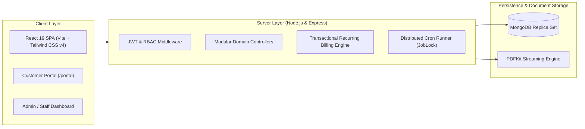

# OrbitBill — Centralized Subscription Management & Recurring Billing System

[](https://opensource.org/licenses/ISC)
[](frontend/)
[](backend/)
[](http://localhost:5000/api-docs)

> **OrbitBill** is an enterprise-grade Subscription Management and Recurring Billing platform designed for modern subscription businesses. It replaces manual spreadsheet tracking with a unified, role-based platform that automates recurring invoice generation, billing calculations, payment reconciliations, and real-time revenue analytics.

---

## 📑 Table of Contents

- [Overview](#-overview)
- [Architecture & Tech Stack](#-architecture--tech-stack)
- [Key Features](#-key-features)
  - [1. Authentication & Role-Based Access Control (RBAC)](#1-authentication--role-based-access-control-rbac)
  - [2. Products, Variants & Subscription Plans](#2-products-variants--subscription-plans)
  - [3. Customer & Quotation Management](#3-customer--quotation-management)
  - [4. Subscription Lifecycle Management](#4-subscription-lifecycle-management)
  - [5. Automated Recurring Billing & Invoice Engine](#5-automated-recurring-billing--invoice-engine)
  - [6. Payments & Ledger Consistency](#6-payments--ledger-consistency)
  - [7. Executive Dashboard & Financial Reports](#7-executive-dashboard--financial-reports)
  - [8. Customer Self-Service Portal](#8-customer-self-service-portal)
- [Screen Inventory (21 Planned Screens)](#-screen-inventory-21-planned-screens)
- [Directory Structure](#-directory-structure)
- [Getting Started](#-getting-started)
  - [Prerequisites](#prerequisites)
  - [1. Backend Setup](#1-backend-setup)
  - [2. Frontend Setup](#2-frontend-setup)
- [Testing & Quality Assurance](#-testing--quality-assurance)
- [API Documentation & Postman Collection](#-api-documentation--postman-collection)

---

## 🌐 Overview

OrbitBill delivers a digital backbone for businesses that earn recurring revenue. Built to satisfy both internal billing teams and external clients:
- **Administrators**: Configure products, variants, recurring billing plans, taxes, discounts, and manage internal staff.
- **Internal Staff**: Manage customer records, generate quotations, convert quotes to active subscriptions, track invoices, and record incoming customer payments.
- **Customers**: Log in to a self-service Customer Portal to view their subscriptions, view/download high-fidelity PDF invoices, track payment histories, and update their billing profiles.

---

## 🛠 Architecture & Tech Stack



- **Frontend**:
  - React 19, React Router v7, Tailwind CSS v4, Lucide React icons.
  - State and list query hooks with debounce search, multi-field filtering, and client/server pagination.
  - Clean, responsive UI with unified authentication, drawers, modals, and badge state indicators.
- **Backend**:
  - Node.js (>= 18), Express 4 with modular MVC architecture.
  - MongoDB (Mongoose 8) with multi-document atomic transactions.
  - Dual-token JWT (short-lived access token + HTTP-only refresh cookie).
  - Pure billing/pricing engine (`roundMoney`, `calcLine`, `isEligible`).
  - Native streaming PDF invoice generator using `pdfkit`.
  - Pino logger, Helmet security headers, Mongo sanitization, compression, and request rate limiting.

---

## ✨ Key Features

### 1. Authentication & Role-Based Access Control (RBAC)
- Unified login, customer registration, and password reset within a single split-screen branded interface.
- Strict password policy: minimum 9 characters with uppercase, lowercase, and special characters.
- Strict backend-enforced RBAC with three defined roles:
  - `admin`: Full administrative control across catalog, finance, reports, and staff management.
  - `staff`: Day-to-day operations (customers, quotations, subscriptions, invoices, and payments).
  - `customer`: Isolated self-service access strictly limited to their own profile, subscriptions, invoices, and payments.

### 2. Products, Variants & Subscription Plans
- Complete product management supporting multiple product types (`service`, `consumable`).
- Flexible variants system with dynamic delta pricing adjustments (e.g. +$560 for premium variants).
- Multi-cadence billing cycles: **Daily**, **Weekly**, **Monthly**, and **Yearly**.
- Plan availability windows, minimum order quantities, and lifecycle flags (`autoClose`, `canPause`, `canRenew`).

### 3. Customer & Quotation Management
- Unified customer registry capturing contact information, GSTIN, and billing addresses.
- Reusable quotation templates with validity periods and line item discounts.
- 1-click conversion from quotation directly into confirmed subscriptions.

### 4. Subscription Lifecycle Management
- Unique, collision-free subscription numbering (`SUB-YYYY-NNNNN`).
- Robust state transitions: `draft` ➔ `quotation` ➔ `confirmed` ➔ `active` ➔ `paused` ➔ `closed`.
- Full audit history tracking transitions (`statusHistory`) with timestamps and user references.

### 5. Automated Recurring Billing & Invoice Engine
- Automated recurring invoice generation via MongoDB atomic transactions.
- Idempotent execution guaranteed via compound unique keys (`billingKey: "<subscriptionId>:<YYYY-MM-DD>"`).
- Catch-up processing for missed billing dates.
- Automatic tax calculation and discount application (fixed amount or percentage, usage limit caps, and validity checks).
- Invoice state machine (`draft` ➔ `confirmed` ➔ `paid` / `cancelled`).

### 6. Payments & Ledger Consistency
- Record partial and full payments against confirmed invoices across methods (`bank_transfer`, `upi`, `card`, `cash`, `cheque`).
- Ledger recomputation: `amountPaid` and `amountDue` are calculated dynamically from active recorded payments to eliminate floating-point drift.
- Automatic status transitions: invoices mark as `paid` when `amountDue === 0`.
- Voiding support: administrators can void payments, seamlessly reopening paid invoices (`paid` ➔ `confirmed`).

### 7. Executive Dashboard & Financial Reports
- Aggregation pipelines (`$facet`) powering real-time financial KPIs.
- In-memory TTL caching with automatic invalidation upon financial mutations.
- Normalized Monthly Recurring Revenue (MRR) formulas:
  - `daily * 30`
  - `weekly * (52 / 12)`
  - `monthly * 1`
  - `yearly / 12`
- Overdue aging analysis buckets (`1-30`, `31-60`, `61-90`, `90+` days) and RFC 4180 streaming CSV report exports.

### 8. Customer Self-Service Portal
- Tenant-isolated endpoints strictly scoped by the authenticated user's `customerId`.
- Access attempt to other tenants returns `404 Not Found` (preventing ID enumeration).
- Direct PDF invoice generation and download.
- Editable customer contact & billing profile drawer.

---

## 🖥 Screen Inventory (21 Planned Screens)

| # | Screen | Route | Description |
|---|---|---|---|
| 1 | **Auth** | `/auth` | Branded split-screen Login, Signup, and Forgot Password |
| 2 | **Dashboard** | `/dashboard` | Executive KPI cards, MRR metrics, charts, and activity feeds |
| 3 | **Products** | `/products` | Catalog listing with type, pricing, and status toggles |
| 4 | **Product Management** | `/products/new`, `/:id/edit` | Product creation, pricing, notes, and variant configuration |
| 5 | **Plans** | `/plans` | Subscription plan management with cycle & rule options |
| 6 | **Customers** | `/customers` | Customer directory with search, filter, and quick view |
| 7 | **Customer Details** | `/customers/:id` | Contact info, linked quotes, active subs, and invoice history |
| 8 | **Quotations** | `/quotations` | Quotation listing and status tracking |
| 9 | **Quotation Management** | `/quotations/new`, `/:id/edit` | Create quote, configure lines, taxes, discounts, convert to sub |
| 10 | **Subscriptions** | `/subscriptions` | Subscription management with status filtering |
| 11 | **Subscription Details** | `/subscriptions/:id` | Line breakdown, lifecycle controls (pause, renew, close) |
| 12 | **Invoices** | `/invoices` | Invoice ledger, status filters, trigger billing engine |
| 13 | **Invoice Details** | `/invoices/:id` | Line item breakdown, payment history, confirm/cancel, PDF view |
| 14 | **Taxes** | `/taxes` | Tax rates and application rules |
| 15 | **Discounts** | `/discounts` | Discount codes, percentage/fixed amounts, usage caps |
| 16 | **Payments** | `/payments` | Payment ledger, record payment modal, void payment |
| 17 | **Reports** | `/reports` | Financial summaries, revenue breakdowns, aging overdue reports |
| 18 | **Staff** | `/staff` | Staff directory and account creation (Admin only) |
| 19 | **Customer Dashboard** | `/portal` | Customer overview with active subs, outstanding balance, receipts |
| 20 | **My Subscriptions** | `/portal/subscriptions` | Customer subscription viewer (active & historical) |
| 21 | **My Invoices** | `/portal/invoices` | Customer invoice viewer, status tracking, streaming PDF download |

---

## 📂 Directory Structure

```
FLUX/
├── backend/                        # Node.js Express REST API
│   ├── src/
│   │   ├── config/                 # DB, logger, environment variable schema
│   │   ├── constants/              # System constants (roles, permissions, cycles)
│   │   ├── emails/                 # Transactional email service & templates
│   │   ├── middlewares/            # Auth, RBAC, error handler, rate limiters
│   │   ├── modules/                # Domain modules (auth, products, plans, customers,
│   │   │                           #  quotations, subscriptions, invoices, payments,
│   │   │                           #  taxes, discounts, reports, portal, staff)
│   │   ├── utils/                  # Price engine, dates, sequence generator, ApiError
│   │   ├── app.js                  # Express app definition
│   │   └── server.js               # Server entry point & graceful shutdown
│   ├── scripts/                    # Database seeds (admin, demo data, E2E test runner)
│   ├── tests/                      # Unit & integration test suites
│   ├── package.json
│   └── README.md
├── frontend/                       # React 19 + Tailwind v4 + Vite Application
│   ├── public/                     # Static assets (Logo.png, icons, favicon)
│   ├── src/
│   │   ├── components/             # Reusable UI primitives (Button, Modal, Drawer, etc.)
│   │   ├── context/                # AuthContext & ToastContext
│   │   ├── features/               # Domain pages and UI features
│   │   ├── hooks/                  # Custom hooks (useListQuery, etc.)
│   │   ├── lib/                    # Axios API client, formatting utilities
│   │   ├── routes/                 # AppRoutes & RoleRoute permission guards
│   │   ├── App.jsx
│   │   └── main.jsx
│   ├── index.html
│   ├── package.json
│   └── vite.config.js
├── docs/                           # Documentation, PRD & problem statement
│   ├── PRD.md
│   ├── problem-statement-md
│   └── schema.mmd
└── postman/                        # Postman collection with automated test scripts
    └── OrbitBill.postman_collection.json
```

---

## 🚀 Getting Started

### Prerequisites
- **Node.js** >= 18.0.0
- **npm** >= 9.0.0
- **MongoDB** >= 6.0 (running as a Replica Set for transactional support)

### 1. Backend Setup

```bash
# Navigate to the backend directory
cd backend

# Copy environment configuration
cp .env.example .env

# Install backend dependencies
npm install

# Seed administrator account (admin@orbitbill.com / Admin@12345)
npm run seed:admin

# (Optional) Seed full demo dataset (Catalog, Customers, Subscriptions, Invoices)
npm run seed:demo

# Start backend development server (Runs on http://localhost:5000)
npm run dev
```

### 2. Frontend Setup

```bash
# Open a new terminal and navigate to the frontend directory
cd frontend

# Install frontend dependencies
npm install

# Start frontend development server (Runs on http://localhost:5173)
npm run dev
```

Visit `http://localhost:5173` in your browser. Default Admin credentials:
- **Email**: `admin@orbitbill.com`
- **Password**: `Admin@12345`

---

## 🧪 Testing & Quality Assurance

### Backend Automated Test Suite
The backend contains comprehensive unit and integration tests powered by Jest and Supertest with an in-memory MongoDB runner:
```bash
cd backend
npm test
```
*Result: 4 passed test suites, 27 passing tests (pricing calculations, date handling, state machines, and end-to-end invoice/payment flows).*

### Frontend Lint & Production Build
```bash
cd frontend

# Run ESLint (Clean with 0 errors and 0 warnings)
npm run lint

# Run Vite production build
npm run build
```

### End-to-End Workflow Smoke Test
An automated smoke test validates the full 8-step lifecycle:
```bash
cd backend
node scripts/testInvoiceFlow.js
```

---

## 📖 API Documentation & Postman Collection

- **Interactive Swagger UI**: When the backend server is active, navigate to `http://localhost:5000/api-docs` to explore all endpoints, request schemas, and sample responses.
- **Postman Collection**: Import [`postman/OrbitBill.postman_collection.json`](file:///home/ariont/Code/Hackathons/FLUX/postman/OrbitBill.postman_collection.json) into Postman for pre-configured requests with automated environment token extraction.
